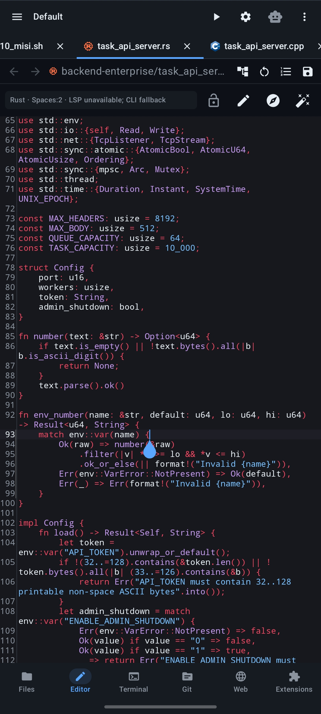

# Droide

Droide is an Android code editor and development workspace by **BayStudio**.
It combines an editor, interactive Linux terminal, Git, build tools, an integrated
browser and optional AI agents on phones and tablets.

**[Download Droide 1.02](https://github.com/baystudio-dev/Droide-v1.-00/releases/tag/v1.02)**
or read the [release notes](docs/releases/1.02.md).

This repository contains the complete source distribution used for the GitHub
release and F-Droid packaging recipe. Version metadata is in `app/build.gradle.kts`.
F-Droid availability remains subject to its independent build and review process.

## Features

- Multi-tab editing, recovery drafts, search, syntax highlighting and on-demand language servers.
- Ubuntu terminal, SSH, PTY applications, Run/Build, debugger and Git integration.
- Optional built-in and external AI agents, MCP servers, skills and media tools.
- Project import/export and adaptive portrait/landscape workspaces.
- Optional shared-file access for terminal and agents, and project access through Android Files.

## Install and build

Android 10 or newer is required. Ubuntu requires an ARM64 process. First use offers
**Install environment** or **Not now**; the approximately 30 MB Canonical download
requires explicit consent. Completed installations and user packages are reused.
Editing remains available when setup is postponed.

See [F-Droid build instructions](docs/distribution/fdroid.md) for the supported
JDK, Gradle, Android SDK/NDK and exact build command. This source distribution
does not contain prebuilt runtime libraries, a root filesystem, compilers, private
keys or Gradle wrapper binaries. Use `tools/build_fdroid_candidate.py`; the regular
binary-backed release instructions do not apply to this export.

The [packaging recipe](tools/fdroid/com.baystudio.droide.yml) retains the immutable
1.01 entry and adds 1.02 (46), targeting `v1.02-fdroid`. The recipe does not establish
F-Droid acceptance; its tag must identify the verified release source. The
1.02 entry enables shared-file support with `--device-storage`. Native engines
and compatibility libraries are compiled from their corresponding source.
Dependencies remain locked and checksum-verified.
Release builds run lint and APK, JNI, native, asset and alignment verification.

## Distribution and privacy

AI services and external executables are optional. Providers may require accounts,
API keys or payment. Downloaded tools bypass F-Droid's review; installation requires
approval. Proprietary service integrations and third-party marks are disclosed in
the packaging metadata and [legal notices](app/src/main/assets/legal/THIRD_PARTY_NOTICES.md).

Test APKs use a development certificate and are not production updates. APKs signed
with different keys cannot update each other. F-Droid signing and acceptance remain
subject to the packaging review.

The GitHub 1.02 APK uses the original production signing identity. Install it over
the existing GitHub release to preserve application data. Development-signed APKs
use a different identity; see the release notes before changing distribution channels.

## Contributing

See [contributing](CONTRIBUTING.md), [testing](docs/TESTING.md) and the
[documentation index](docs/README.md). Keep dependency verification, corresponding
source, regression tests and license notices intact.

## Project

- [Website](https://droide.rekacipta.biz.id)
- [Issue tracker](https://github.com/baystudio-dev/Droide-v1.-00/issues)
- [F-Droid packaging request](https://gitlab.com/fdroid/rfp/-/work_items/4776)
- [License](LICENSE) and [third-party scope](LICENSE_SCOPE.md)

Droide-owned application code is LGPL-3.0-only. Dependencies retain their respective
licenses. Corresponding sources, provenance and license texts are included.
