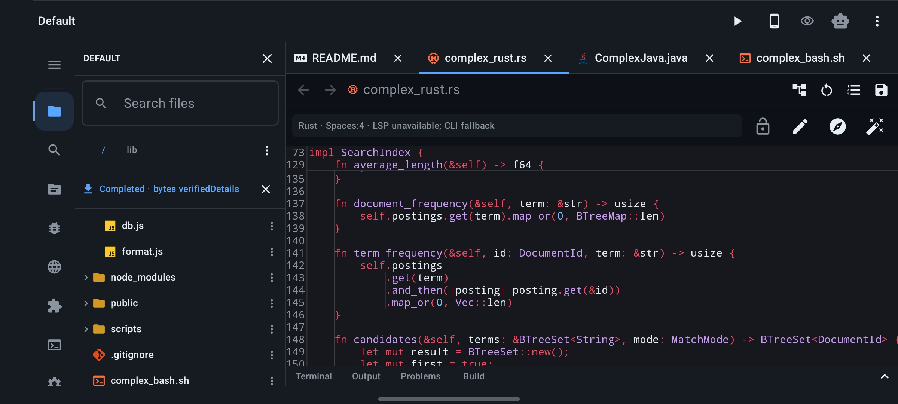
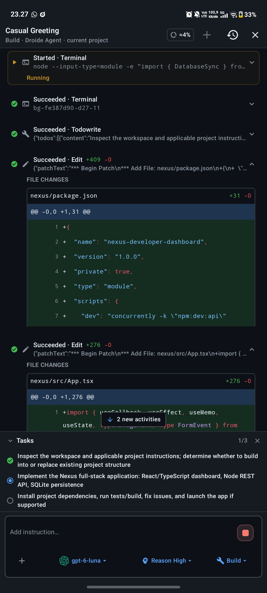
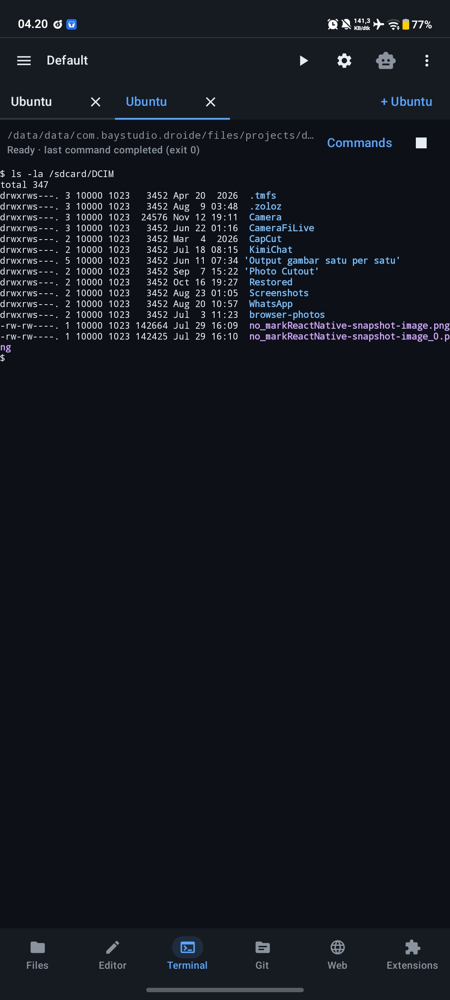
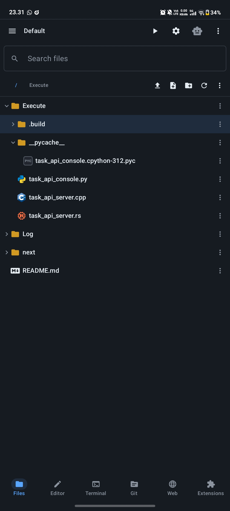
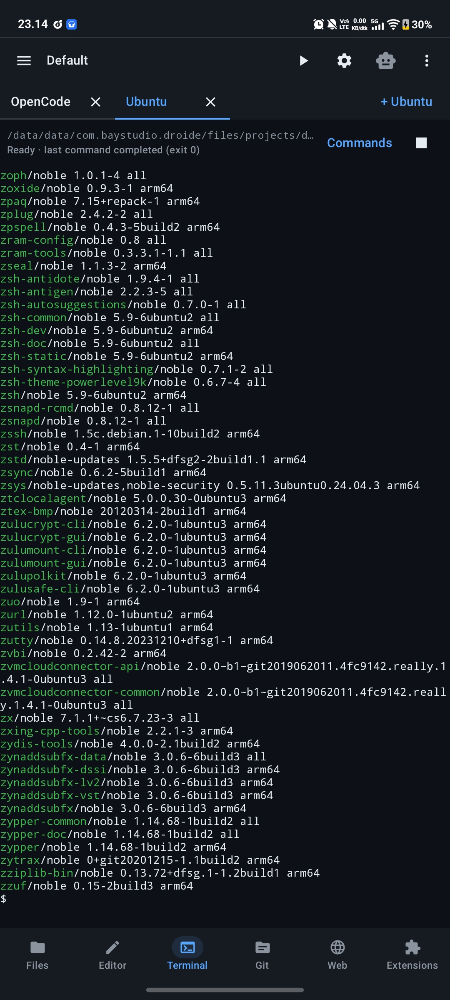

  

<h1 align="center">Droide</h1>

  <strong>An Android IDE for phones and tablets.</strong> 
  Code editor · Linux terminal · Git · AI tools

  
  
  

  <a href="https://github.com/baystudio-dev/Droide/releases/tag/v1.03.3"><strong>Download 1.03.3</strong></a> ·
  <a href="docs/README.md">Documentation</a> ·
  <a href="https://droide.rekacipta.biz.id">Website</a> ·
  <a href="https://github.com/baystudio-dev/Droide/issues">Report a bug</a>

   
  Landscape workspace with Explorer, editor tabs and terminal panels.

**Droide** is a native Android development environment. It combines code editing, a Linux terminal, Git, build tools, an integrated browser and optional AI agents. Portrait and landscape layouts support phones, tablets and external keyboards.

## Features

- **Editor.** Multi-tab editing, syntax highlighting, project search, recovery drafts and on-demand language servers.
- **Terminal.** A persistent Ubuntu environment with interactive PTY sessions, SSH and command-line tools.
- **Run, build and debug.** Run the active file, build a project, inspect output and use language-specific debugging tools.
- **AI integrations.** Optional built-in and external agents, configurable providers, MCP servers, skills and document, audio and image tools.
- **File access.** Project import/export, optional Android shared-storage access for terminal and agents, and saved projects visible through Android Files.
- **Adaptive workspace.** Portrait and landscape layouts with adjustable editor, sidebar, terminal and agent panels.

## Screenshots

  
  
   
  Code editor · AI workspace · Shared files

Select a screenshot to view it at full size.

Explorer and terminal screenshots

  
  

## Get started

1. **Install Droide.** Download the production APK from [GitHub Releases](https://github.com/baystudio-dev/Droide/releases/tag/v1.03.3). Android 10 or newer is required; the Ubuntu environment requires ARM64.
2. **Open a project.** Create or import a project. Choose **Install environment** when you need Linux tools, or **Not now** to start editing without setup.
3. **Configure development tools.** Install language services and toolchains on demand. Configure an AI provider or external agent if needed.

The first Ubuntu download is approximately 30 MB and comes from Canonical after your approval. Completed installations and installed packages are reused across launches and updates. Compiler SDKs are installed separately when needed.

For Android storage, see the [shared-file and Android Files guide](docs/releases/1.02.md#changes). Shared-file access requires Android 11 or newer and an explicit permission grant. Android 10 supports the file picker and export workflows.

The GitHub 1.03.3 APK uses the original production signing identity. Install it over an existing GitHub production release to retain application data. Read the [upgrade guidance](docs/releases/1.03.3.md#download-and-upgrade) before switching from a test APK or another distribution.

F-Droid packaging has been [requested](https://gitlab.com/fdroid/rfp/-/work_items/4776). Availability depends on its independent build and review process.

## Documentation and development

| Guide | Contents |
| --- | --- |
| [Documentation](docs/README.md) | Workbench guides, integrations and project structure |
| [Build from source](docs/distribution/fdroid.md) | Required tools, source export and the release build procedure |
| [Architecture](docs/ARCHITECTURE.md) | Application structure and ownership boundaries |
| [Testing](docs/TESTING.md) | Regression tests, dependency checks and verification scope |
| [Published release notes](docs/releases/1.03.3.md) | Changes and upgrade instructions for the GitHub release |
| [Private candidate notes](docs/releases/1.03.4.md) | Changes under test in version 1.03.4 (51) |

This repository contains the complete source distribution for the GitHub release and the [F-Droid packaging recipe](tools/fdroid/com.baystudio.droide.yml). Application and native components build from corresponding source with locked, checksum-verified dependencies. Version metadata is defined in `app/build.gradle.kts`.

Follow the source build procedure using `tools/build_fdroid_candidate.py` with `--device-storage` to retain the release's shared-file capability. This export excludes prebuilt runtime libraries, compiler bundles, root filesystem images, Gradle wrapper binaries and private signing material. The regular binary-backed build instructions do not apply to this source distribution.

## Contributing and feedback

See [CONTRIBUTING.md](CONTRIBUTING.md) for the development workflow and review guidance. Include relevant tests with code changes, and retain dependency verification and original license notices.

Use the [issue tracker](https://github.com/baystudio-dev/Droide/issues) for bugs and feature requests. Include your Droide version, Android version and steps to reproduce the problem. Remove credentials and private project content from attachments.

## License and services

Droide-owned code is **LGPL-3.0-only**. See [LICENSE](LICENSE), [COPYING](COPYING), [COPYING.LESSER](COPYING.LESSER), [license scope](LICENSE_SCOPE.md) and [release obligations](RELEASE_AND_COMPLIANCE.md). Third-party components retain their own licenses; corresponding source, provenance and [notices](app/src/main/assets/legal/THIRD_PARTY_NOTICES.md) are included.

AI services and external executables are optional. Providers may require accounts, API keys or payment. Downloaded tools require installation approval and are outside F-Droid's review. Service integrations and third-party marks are disclosed in the packaging metadata and legal notices.

  Made by <strong>BayStudio</strong> · Engineering by <strong>BayZov</strong>

